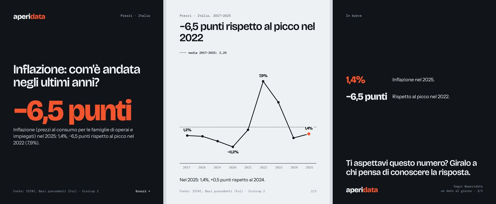

<p align="center"></p>

# aperidata

**Un dato ISTAT al giorno, trasformato in un carosello Instagram, in un set di slide verticali e in un video animato. Senza inventare niente.**

*A pipeline that turns one official Italian statistic per day into an Instagram carousel, vertical slides and an animated MP4 — every number computed from the data, no AI in the loop.*



<sub>Tre slide di un post generato dal codice, dai dati ISTAT dell'inflazione. [Il video che ne esce](docs/esempio-video.mp4) · [un confronto tra aree](docs/esempio-confronto.jpg)</sub>

## Cosa fa

Ogni giorno della settimana ha un tema (soldi, lavoro, popolazione, casa, vita quotidiana). Da `calendario.toml` il programma:

1. **trova i dataset** del catalogo ISTAT per il tema del giorno e prende il più recente non ancora usato;
2. **sceglie la serie** giusta dentro il dataset (il totale, l'indicatore, il territorio completo) con regole esplicite;
3. **scarica i dati** dall'API SDMX di ISTAT, rispettando i suoi limiti, e li controlla;
4. **calcola tutti i numeri** di una possibile storia (ultimo dato, variazioni, picchi, medie) e compone copertina, grafico e chiusura;
5. **disegna** le slide in HTML/CSS con Chromium: JPEG 4:5 per il feed, 9:16 per reel e stories, e un **video MP4** in cui il grafico si costruisce periodo dopo periodo;
6. apre una **redazione** nel browser, in locale, dove rivedi i testi, cambi il grafico o la serie e approvi il post.

## Perché è fatto così

**Niente AI, di proposito.** Un post sui dati vale quanto è vero. Qui ogni cifra viene calcolata dal codice e i testi sono composti da modelli: non c'è niente che possa "allucinare". La redazione controlla poi che nei testi, anche quelli riscritti a mano, non compaia **nessun numero che non sia nei dati**.

**Controlli sui dati, nati da errori veri.** Ogni regola qui sotto esiste perché un post sbagliato è stato generato davvero, e ognuna ha un test:

| Il rischio | Cosa fa il codice |
| --- | --- |
| Una *parte* spacciata per il *tutto* (es. "regione non indicata" come totale del turismo) | scarta le voci residuali e dichiara nel titolo ogni parte scelta |
| Una classifica per aree a cui manca un'area (il "primo" non lo sarebbe) | accetta solo suddivisioni complete dell'Italia e verifica la coerenza con il dato nazionale |
| Un numero indice ("120", base 2021=100) senza significato per chi legge | racconta la variazione, non il livello |
| Un'inflazione già espressa in % trattata come un indice | riconosce le misure che sono già variazioni |
| Valori negativi su colonne o aree (che partono da zero) | in quel caso ammette solo la linea |
| Serie quasi ferme (la popolazione) raccontate in percentuale ("+0,0%") | racconta la differenza in valore, e lo dichiara |
| Dati vecchi | soglia di freschezza per ogni frequenza |

**Rispetto per l'API.** ISTAT accetta poche richieste al minuto: il client aspetta tra una richiesta e l'altra, mette tutto in cache su disco e ricorda per settimane cosa ha già scoperto di ogni dataset (quali frequenze ha, quanto è recente, quali non si lasciano raccontare).

**Persona nel ciclo.** Il codice prepara, una persona decide. Il post non si approva se mancano le unità di misura, se ci sono codici ISTAT o inglese nei testi, o numeri estranei ai dati.

## Come è organizzato

```
calendario.toml ─► categorie ISTAT ─► dataset candidati
                                           │  pipeline/scegli.py     regole di scelta
                                           ▼
                        serie (codici) ─► download + controlli         pipeline/run.py
                                           │  pipeline/racconta.py   menù di numeri → storia
                                           ▼
                        slide (HTML/CSS) ─► Chromium ─► JPEG 4:5 e 9:16  ·  video MP4 (ffmpeg)
                                           │  pipeline/disegna.py
                                           ▼
                        redazione nel browser: rivedi · rigenera · approva   pipeline/redazione.py
```

| File | Cosa fa |
| --- | --- |
| `pipeline/run.py` | la giornata: rotazione dei temi e delle frequenze, storico, cartelle di output |
| `pipeline/scegli.py` | dal dataset alla serie: codici, soggetto, unità, controlli |
| `pipeline/racconta.py` | dai numeri alla storia: menù di numeri e testi a modello |
| `pipeline/disegna.py` | slide con Playwright, video fotogramma per fotogramma + ffmpeg |
| `pipeline/redazione.py` | la redazione locale (server HTTP standard library, nessun framework) |
| `pipeline/ricognizione.py` | facoltativo: legge in anticipo tutto il catalogo per rendere veloci i lanci successivi |
| `sources/istat.py`, `rete.py` | client SDMX con pause, tentativi e cache |
| `templates/` | le slide e il video, in HTML/CSS (Jinja2) |

## Installazione e uso

```bash
python -m venv .venv && source .venv/bin/activate
pip install -r requirements.txt
python -m playwright install chromium

python -m pipeline.run --settimana     # prepara la prossima settimana (la prima volta ci vuole tempo)
python -m pipeline.redazione           # rivedi i post su http://localhost:8765
```

I font (Bricolage Grotesque, Instrument Sans, IBM Plex Mono, tutti open source) si scaricano da soli al primo avvio.
Comandi utili: `--settimane 2`, `--dal 2026-10-12`, `--rifai`; `python -m pipeline.storico` per vedere cosa è già uscito.

Il risultato sta in `output/AAAA/MM/GG/`:

```
post/    slide del carosello (1080×1350)
reel/    le stesse slide in verticale (1080×1920)
video/   il grafico animato (MP4, 12 secondi)
altri/   rapporto, dati usati, didascalia e riepilogo.md
```

## Un bug interessante

Un video uscì fermo dopo un "Salva e rigenera". Il file aveva **due blocchi `moov`** e migliaia di errori di decodifica: due richieste ravvicinate alla redazione (un minuto di attesa senza segnali invita a ricliccare) scrivevano lo stesso file insieme. La correzione ha tre parti: il video si scrive in un file provvisorio e si sostituisce in modo atomico, la redazione esegue una rigenerazione alla volta, e il pulsante si disabilita. `test_due_rigenerazioni_insieme_non_rovinano_il_video` riproduce il guasto con due processi.

## Limiti noti

- L'API di ISTAT a volte non risponde; la pipeline si ferma con garbo e riprende dalla memoria, ma la prima esplorazione è lenta.
- I testi sono a modello: vanno rifiniti in redazione, ed è una scelta (si veda sopra), non una mancanza.
- Non pubblica su Instagram: la pubblicazione resta manuale.
- Testi e nomi dei campi sono in italiano.

## Dati, licenze e marchio

- **Codice**: licenza MIT (vedi `LICENSE`).
- **Dati**: ISTAT, licenza [CC BY 4.0](https://creativecommons.org/licenses/by/4.0/). La fonte e la licenza sono scritte in ogni slide e in ogni didascalia.
- **Font**: SIL Open Font License.
- **Nome e logo "aperidata"**: non sono coperti dalla licenza del codice.
